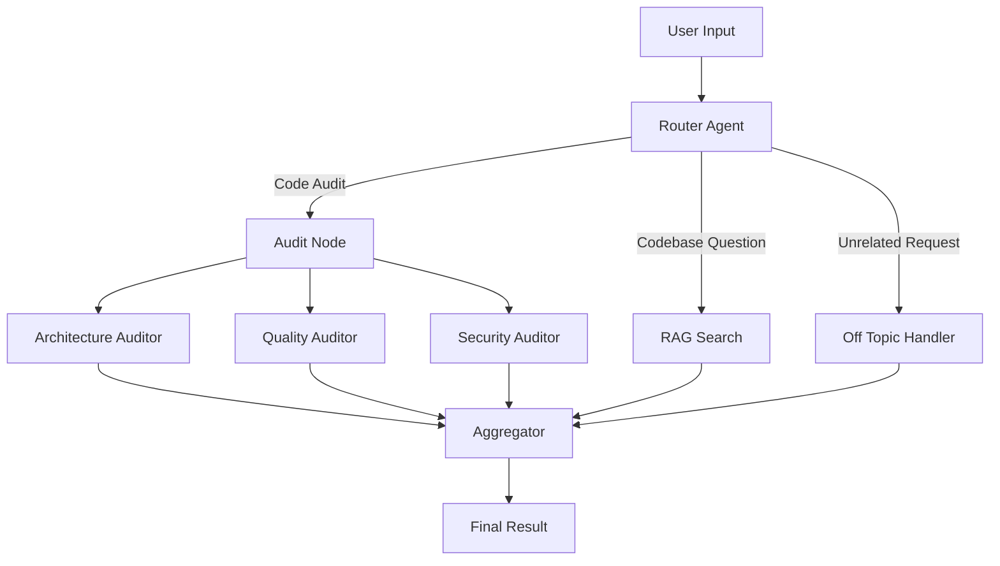

# AI Codebase Auditor

An AI-powered codebase analysis tool built with Python, LangGraph, AST parsing, and Retrieval-Augmented Generation (RAG).

The goal of this project is to analyze Python codebases, identify potential architectural and code-quality issues, review security concerns, and answer questions about how a codebase is structured and implemented.

The system uses specialized AI agents that analyze different aspects of a codebase in parallel, while a routing agent determines whether a user's request requires a full code audit or a codebase-related question answered through RAG.

---

## Features

### Implemented

- **Codebase Scanning:** Recursively scans a target directory and builds a file tree.
- **AST Parsing:** Uses Python's Abstract Syntax Tree (AST) module to extract structural information from Python files.
- **Code Indexing:** Indexes parsed codebase information in a vector store for semantic retrieval.
- **AI Routing:** Uses a router agent to classify user requests and direct them to the appropriate workflow.
- **Parallel Code Auditing:** Uses specialized agents to analyze:
  - Architecture
  - Code quality
  - Security
- **RAG-based Codebase Q&A:** Retrieves relevant codebase information to answer questions about the implementation.
- **Finding Aggregation:** Combines results from the different workflow branches.

### Planned

- Cyclomatic complexity and other code metrics.
- Dependency graph analysis and circular dependency detection.
- Finding prioritization, severity scoring, and deduplication.
- AI-generated code improvement suggestions.
- Incremental analysis of changed files.
- GitHub integration for automated pull request reviews.
- Web-based dashboard and API.

---

## Architecture

The project uses **LangGraph** to orchestrate the AI agents and manage the execution workflow.

At a high level, the system has two main workflows:

1. **Code Audit:** Runs specialized auditing agents in parallel.
2. **Codebase Q&A:** Uses RAG to retrieve relevant code and answer user questions.

### High-Level Architecture



### 1. Codebase Ingestion

Before the graph executes, the application prepares the target codebase.

The ingestion process consists of:

1. **Codebase Walker:** Scans the target directory and collects file information.
2. **AST Parser:** Parses Python files and extracts structural information.
3. **Vector Store:** Indexes the parsed information so it can later be retrieved through semantic search.

This preprocessing stage provides the agents with a shared understanding of the codebase.

### 2. Router Agent

The router is the entry point of the LangGraph workflow.

It analyzes the user's request and determines which workflow should handle it.

It supports three routes:

| Route | Purpose |
|---|---|
| `code_audit` | Perform a complete codebase audit |
| `rag_search` | Answer questions about the codebase |
| `off_topic` | Handle requests unrelated to the codebase |

### 3. Parallel Audit Agents

When the router selects the `code_audit` route, the workflow enters the audit node.

The audit node fans out execution to three specialized agents.

**Architecture Auditor**

Analyzes the overall architecture and looks for potential design and structural problems.

**Quality Auditor**

Reviews code quality, maintainability, readability, and potential code smells.

**Security Auditor**

Examines the code for potential security vulnerabilities and unsafe implementation patterns.

These agents work independently, allowing different aspects of the codebase to be analyzed concurrently.

### 4. RAG Search

When the user asks a question about the codebase, the router directs execution to the RAG search node.

The RAG workflow:

1. Receives the user's question.
2. Searches the vector store for relevant indexed code information.
3. Retrieves relevant matches.
4. Uses the retrieved context to generate an answer.

For example:

- How is authentication implemented?
- Where is the database connection configured?
- How are services organized?
- Which modules depend on a particular component?

### 5. Aggregator

The aggregator is responsible for collecting the results from the workflow branches.

For code audits, it receives findings from the architecture, quality, and security agents.

It also serves as the shared destination for the RAG and off-topic branches.

The current implementation establishes the aggregation stage; more advanced finding deduplication, prioritization, and report generation are planned improvements.

---

## Technology Stack

| Technology | Purpose |
|---|---|
| Python | Core application language |
| LangGraph | AI agent orchestration and workflow management |
| Python AST | Static code parsing and structural analysis |
| Vector Store | Semantic indexing and retrieval |
| LLM | Code analysis, reasoning, and response generation |
| Rich | Terminal output and progress display |
| Pydantic | Structured data validation |

---

## Local Setup

Follow these steps to run the project locally.

### Prerequisites

Make sure you have installed:

- Python 3.11 or compatible version
- Anaconda or Miniconda
- Git

### 1. Clone the Repository

```bash
git clone https://github.com/parimal00/codebase-auditor

cd codebase-auditor
```

Replace `https://github.com/parimal00/codebase-auditor` with your GitHub repository URL.

### 2. Create the Conda Environment

```bash
conda create -n codebase-auditor python=3.11
```

### 3. Activate the Environment

```bash
conda activate codebase-auditor
```

### 4. Install Dependencies

```bash
pip install -r requirements.txt
```

### 5. Configure Environment Variables

If the project requires an API key or other configuration, create a `.env` file in the project root.

Example:

```env
GOOGLE_API_KEY=your_api_key_here
```

Use the actual environment variable names expected by your application. Never commit API keys or other secrets to GitHub.

### 6. Run the Application

```bash
python main.py
```

The application will scan the target directory, parse Python files, index the extracted information, and execute the configured LangGraph workflow.

> **Note:** The default target directory and available CLI options depend on the current `main.py` implementation.

---

## Project Structure

The project is organized into separate modules to keep ingestion, agent orchestration, vector indexing, and reporting responsibilities independent.

```text
codebase-auditor/
│
├── src/
│   ├── agents/
│   │   ├── graph_router.py
│   │   ├── ...
│   │
│   ├── ingestion/
│   │   ├── codebase_walker.py
│   │   ├── ast_parser.py
│   │   └── ...
│   │
│   ├── vector_store/
│   │   ├── code_indexer.py
│   │   └── ...
│   │
│   └── reporting/
│       ├── console_reporter.py
│       ├── exporter.py
│       └── ...
│
├── main.py
├── requirements.txt
├── .env.example
├── .gitignore
└── README.md
```

The tree above represents the main module organization. Add the remaining filenames as they exist in the repository.

---

## How the Workflow Executes

The application follows this sequence:

1. The user provides a target codebase and a request.
2. The codebase walker scans the directory.
3. The AST parser extracts structural information from Python files.
4. The vector store indexes the parsed information.
5. The LangGraph workflow is initialized with the codebase context and user request.
6. The router selects the appropriate workflow.
7. Specialized agents execute the audit or RAG workflow.
8. The aggregator collects the results.
9. The application displays the final response and, for audits, can export a report.

---

## Project Goals

This project is being developed as an exploration of how AI agents, static code analysis, and retrieval systems can work together to understand and evaluate software codebases.

The long-term goal is to build a codebase auditor that goes beyond simply identifying code smells: it should understand project architecture, explain implementation decisions, identify potential risks, and provide actionable engineering recommendations.

---

## Development Status

<text>🚧 **Active Development**</text>

This project is under active development. New analysis capabilities, improved retrieval, reporting, and integrations will be added incrementally.